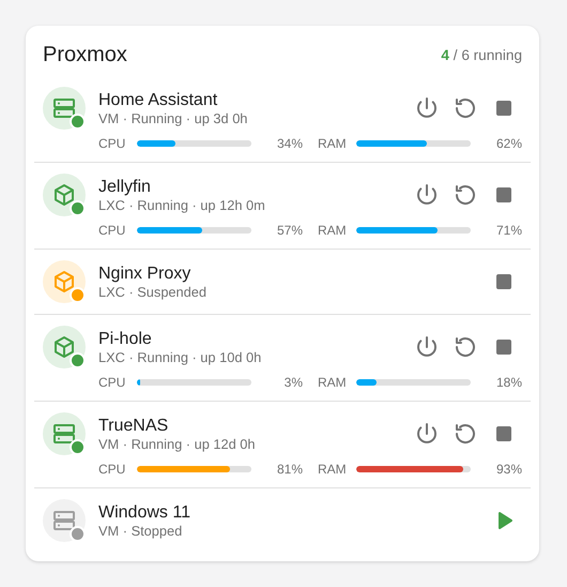

# Proxmox Guests Card

A dependency-free custom Lovelace card for Home Assistant that shows the status and power controls for your Proxmox VMs and LXC containers.



Built for the [dougiteixeira/proxmoxve](https://github.com/dougiteixeira/proxmoxve) integration, but any integration that exposes guests as entities works if you map them manually.

## Features

- Running / stopped / paused status with coloured indicator and uptime
- CPU, RAM and disk usage bars (amber at 75%, red at 90%, configurable)
- Start, shutdown, reboot and force-stop buttons, shown only when they make sense for the guest's current state
- Two-click confirmation on shutdown, reboot and force-stop
- Auto-discovery of guests, or fully manual entity mapping
- Click a guest to open its more-info dialog

## Installation

### HACS (custom repository)

1. HACS → ⋮ → Custom repositories → add `https://github.com/sargeantpepper/ProxmoxCustomCard` as type **Dashboard**.
2. Install **Proxmox Guests Card** and reload your browser.

### Manual

1. Copy `proxmox-guests-card.js` to `/config/www/`.
2. Settings → Dashboards → ⋮ → Resources → add `/local/proxmox-guests-card.js` as a **JavaScript module**.
3. Hard-refresh the browser.

## Usage

### Visual editor (no YAML)

Add the card from the dashboard editor, then use **Guests → + Add guest**. Give each guest a name and type, then pick its status, CPU, memory, disk and uptime entities and its start, shutdown, reboot and stop buttons from the dropdowns. Everything except the name is optional.

Reorder guests with the ↑ / ↓ buttons or by dragging the ⠿ handle. The card shows guests in the order of this list. With auto-discovery on, guests you list here come first in your chosen order and the rest follow alphabetically.

### Auto-discovery

```yaml
type: custom:proxmox-guests-card
discover: true
title: Proxmox
```

Discovery reads the entity and device registries, so it needs an admin user. Other users should use manual mapping.

### Manual mapping

```yaml
type: custom:proxmox-guests-card
title: Proxmox
guests:
  - name: Home Assistant
    type: vm            # vm | lxc (changes the icon only)
    node: pve1
    status: sensor.qemu_homeassistant_101_status
    cpu: sensor.qemu_homeassistant_101_cpu_used
    memory: sensor.qemu_homeassistant_101_memory_used_percentage
    uptime: sensor.qemu_homeassistant_101_uptime
    start: button.qemu_homeassistant_101_start
    shutdown: button.qemu_homeassistant_101_shutdown
    reboot: button.qemu_homeassistant_101_reboot
    stop: button.qemu_homeassistant_101_stop
```

Entity IDs above are examples; check yours under Developer Tools → States. Every field except `name` or `status` is optional.

### Options

| Option | Default | Description |
|---|---|---|
| `title` | `Proxmox` | Card title |
| `discover` | `false` | Auto-discover guests from the proxmoxve integration |
| `include` | | Regex; only discovered guests whose name matches |
| `exclude` | | Regex; hide discovered guests whose name matches |
| `type` | | `vm` or `lxc`; limit discovered guests to one kind |
| `guests` | | Manual guests, or overrides for discovered ones (use `match: "<name>"`) |
| `collapsed_title` | `More guests` | Heading of the collapsed section |
| `collapsed_open` | `false` | Start with the collapsed section expanded |
| `compact` | `false` | Hide the usage bars |
| `show_actions` | `true` | Show the power buttons |
| `show_summary` | `true` | Show the "N / total running" count |
| `warn_at` / `crit_at` | `75` / `90` | Usage bar colour thresholds (%) |

### Per-guest fields

`name`, `type`, `node`, `collapsed`, `icon`, `status`, `cpu`, `memory`, `disk`, `uptime`, `start`, `shutdown`, `reboot`, `stop`.

The action fields accept `button`, `switch` or `script` entities.

### Collapsed section

Set `collapsed: true` on any guest (or tick **Put in collapsed section** in the editor) to move it into a section at the bottom that expands when you click its header. The header shows how many guests it holds and how many are running. Guests keep their relative order within each section.

```yaml
guests:
  - match: Windows 11   # override for an auto-discovered guest
    collapsed: true
```

## Notes

- The proxmoxve integration disables its power buttons by default. Enable them on each guest's device page (hidden entities), and make sure the Proxmox user has the `VM.PowerMgmt` privilege.
- The `uptime` field accepts either an uptime sensor (a number of seconds, minutes, hours or days) or a timestamp sensor such as the integration's last boot sensor.
- Usage bars only draw for sensors reporting in `%`; other units are shown as text.
